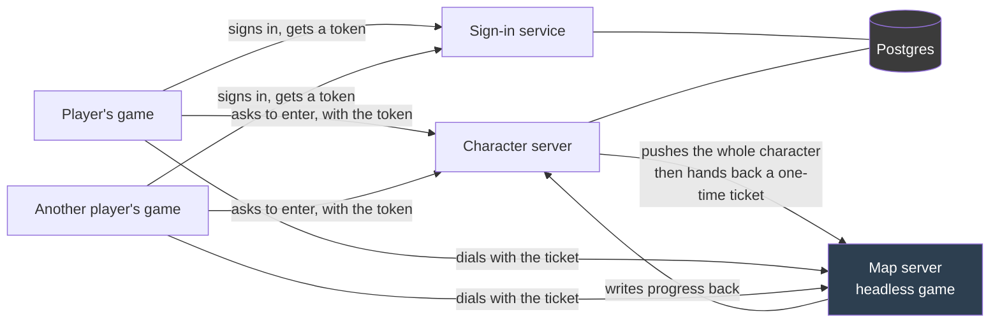
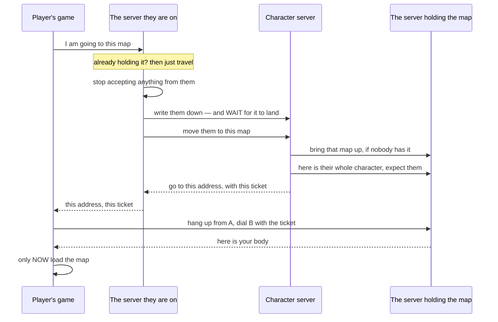
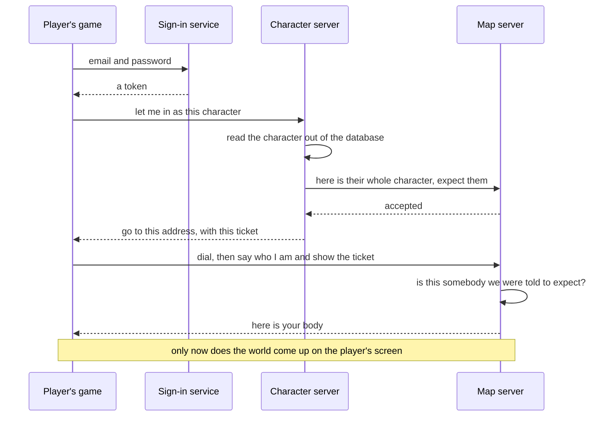
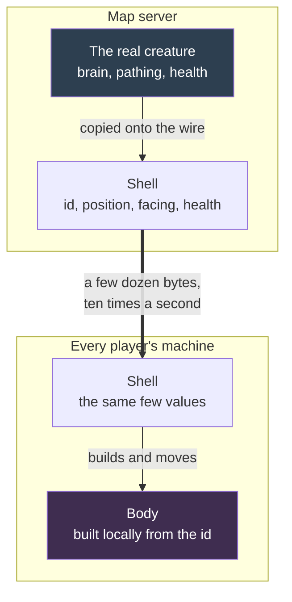
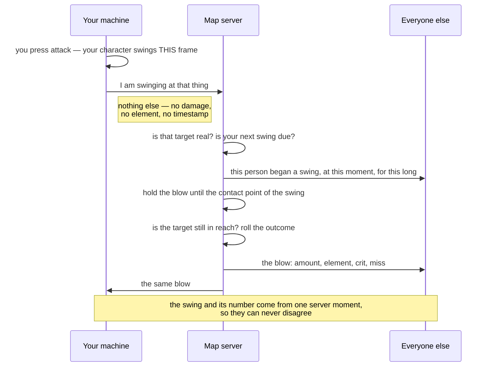

# Networking — Architecture

The whole shape of the multiplayer layer on one page: the machines, what each one is allowed to decide, how a
person gets into the world, and what crosses the wire while they are in it.

**Start here, then go deeper:**

- [Implementation Notes](implementation-notes.md) — what is actually built, the conventions, and every trap already paid for. **Read before touching anything networked.**
- [Action Alarms](action-alarms.md) — how a body says what it is *doing* across the wire.
- [Readiness Audit](readiness-audit.md) — the July survey that chose this shape. Historical; kept for the reasoning.
- [Starting the Network](starting-the-network.md) — how to stand it all up and how to tell each step worked.

**A rendered version of this page**, with the same diagrams, is published at <https://claude.ai/code/artifact/2af21c76-92b4-4fe3-af06-1f7d0a7848ca> — a view for showing somebody, not a second source of truth. **This file is the truth**; when they disagree, this one is right and the other is stale.

---

## The four processes

Four programs and one database. The arrangement is Ragnarok Online's, deliberately: the thing running the world
never touches the store, and a player's own credentials never open it.

**The map server has no database and never will.** Everything that happened in the world becomes permanent by
being sent to the character server, which is the only thing that writes.

**Two roads that never cross.** A *person's* token reaches their own characters and nothing else. The two
*servers* recognise each other by a shared secret, which registers a map server, receives a pushed character,
writes a save back and writes a changed hotbar back — and cannot read anybody's character list. Each is refused on the other's road.

**A player's own machine cannot write a character at all.** It used to be able to, refused only while it happened
to have a body — which left every moment between bodies open. That door is gone: a character's progress is
written by the map server running the world it is in, and by nothing else. A client never learns what really
happened in a fight, so anything it wrote would be older than the truth and would land on top of it.

**One sign-in per account, and the newest one wins.** Signing in stamps a marker on the account and carries it in
the pass. Signing in again replaces the marker, so the older pass stops being let into the world and the machine
holding it is thrown out of it. Nothing downstream could catch two machines playing one character — by then
nothing knows the two are the same person — so it is stopped where it starts.

---

## One world, and which map server holds it

**The game has one map, `world`, and one map server holds it.** No map server is told which map to hold when it
starts; they are identical and pre-assigned nothing.

- **The world is brought up when somebody wants it.** When a player enters and no map server is holding the world,
  the character server picks the **quietest** map server still answering — weighing how many players and creatures
  each reports — tells it to bring the world up, and waits until it is genuinely standing before pushing the
  character across. Everybody after that is sent to the server already holding it.
- **Nothing unloads the map once it is up.** What comes and goes is the world's ground: the map server keeps the
  squares around every player and under every awake spawn area loaded, and puts a spawn area nobody is near to
  sleep with its creatures banked, waking it — respawn waits kept — once somebody comes near and its ground is in.
- **A character saved in a map the build no longer has** is sent to the build's starting map, the world.

### Moving to a map another server holds

Built, and nothing sets it off today: the world layout lists no doors, so every door is refused (a game master's
excepted), and every save point, Keeper and `/tp` destination is in the one world. A player's machine never travels on its
own; it asks, because only the server can find out which process holds the far side, bring it up, or refuse.

**Written down first, and the write waited for.** The map they are going to is handed the stored character, so
starting the move before that write landed would hand over whoever they were up to fifteen seconds ago.

**Nothing they send is acted on from the moment the move starts.** Their state on the old server is finished, so
a swing or a pick-up accepted after that happens to a copy nobody will read again — the player would simply lose
it.

**Dial first, load the map second.** The two failures are not alike. Arriving before the map is up is untidy and
fixes itself the moment it lands; loading the map and then failing to dial leaves somebody standing in a world
with nobody in it. So the risky step is taken while there is still somewhere to be put back to.

**A move that fails leaves them exactly where they were**, told why. Nothing was handed over, so there is nothing
to undo.

---

## Getting in

A player is **announced before they knock**. The character server hands their whole character to the map server
first, and only then tells them where to go and gives them a one-time ticket. A connection that cannot produce
one was never announced and is nobody.

**Where this goes wrong, and what it looks like.** If the game is started without being told where the character
server is, it has nobody to ask, so it is never announced — and the map server refuses it at the door, forever.
It now says so and stops instead of retrying in silence. The exact launch command is in
[Starting the Network](starting-the-network.md).

---

## Who decides what — the single answer

This table is the one home for it. The other documents in this folder point here rather than keeping copies.

| Thing | Who owns it | Everyone else |
| --- | --- | --- |
| Where **you** are | your machine moves you; the server **checks** it | watches |
| Where anything else is | the server | watches |
| A creature's brain, path and target | the server | watches |
| A townsperson: which body they wear, where they wander, and the line they speak | the server | watches, and puts the line in a bubble |
| Whether a blow lands, and for how much | the server | is told, and shows it |
| **When a blow lands inside a swing** | the server, on its own clock | is told |
| Health, death, revival | the server | is told |
| **When your own animation starts on your own screen** | **your machine** | — |
| **When your action starts on everyone else's screen** | the server's clock | is told, and shows it |
| **Which pose your body is holding** | **your machine**, reported on the frame it changes | is told, and holds it |
| **That a visual reaction happened** (a hit spark, a poison glow, a heal sparkle) | whichever machine **decided the event** — in a shared world, always the server | is told, and plays it on the body it draws |
| **Which clip, which model, how it looks** | **each machine, locally** | — |
| Your bag, money and worn gear | the server | asks, is sent the result |
| Writing to the database | the **character server**, only | the map server pushes progress to it and never writes |
| **What time it is in the world** | the **clock of the machine running the world** | is told it when it is handed a body, and counts forward |
| **Which server holds the world** | the **character server** | a map server is told, and never chooses |
| **Which sign-in is the live one** | the **sign-in service** | the newest one takes over; older ones are refused at the door |

**The one-line rule:** your machine owns how things *look*, and when *your own* body reacts to *your own* input.
The server owns everything that is *true*.

**A player's machine owns no fact and decides no outcome.** That is literal: both damage channels refuse to act
anywhere but the server, the bag refuses to be added to anywhere but the server, and a save from a player's own
machine is refused while they are in a world.

---

## One networked thing is two objects

**Why, and do not undo this.** Bodies are heavy — a character is a rigged model, a creature is a baked asset.
Sending an **id** and letting each machine build its own copy costs a few dozen bytes and reuses the spawn code
the game already had, instead of shipping models over the wire.

**A watched copy does not think.** Its brain is silenced and its mover switched off — but the brain is left
switched *on* as a component, because the registry it belongs to is how the game finds something to attack,
picks area-effect targets, draws map blips, and — for a townsperson — is how pressing F finds somebody to talk to.

**Townsfolk cross the wire the same way, and it is the same three objects.** The town is populated only on the
machine that owns the world; each person is announced with the name of the body they wear, and every player
close enough builds their own copy of that person from the name. Before this, every machine populated its own
town, so two people standing in the same square saw different villagers in different places saying different
things. Talking to one is a request the server carries out — it stops them and turns them to face the speaker,
so everybody in the square watches that conversation happen rather than only the person holding it.

---

## Three kinds of traffic, three different rules

Confusing these is how a channel ends up carrying something it cannot serve. Everything that crosses is one of
these three, and a latecomer is treated differently by each.

| Kind | Examples | How it is sent | Somebody who arrives late… |
| --- | --- | --- | --- |
| **Continuous state** | position, facing, health, ground speed, the travel gear, the pose a body is holding | a value, re-sent and smoothed | is told the current value |
| **An action that expires by itself** | a swing, a skill's release swing, a cast wind-up, a death | which action, when it began, how long | **joins it at the right frame** |
| **A one-off with no duration** | a damage number, a hit spark, a heal sparkle, a crit flag | announced once | **is told nothing** |
| **Something that lasts until it is over** | a poison glow, the charge-up glow under a cast | named when it starts, named again when it ends | is told nothing, and picks it up next time it starts |

**Which bucket something goes in is decided by one question: can both machines PREDICT it?** If the shape is
known to both — a scripted jump arc, a timed swing — send the shape once and let each machine draw it; sampling it
instead is both coarser and later, however often you sample. Send a stream of values only for something neither
side can work out, like where somebody chose to walk. (A jump's lift was filed as continuous state first and came
out 135 ms late with four values on the way up; its sideways half genuinely IS unpredictable and stays streamed.)

A late *number* is dropped; a late *action* is joined. Opposite rules, so one channel cannot carry both — but
both halves of one event are fired from the same instant on the server, or the number floats up before the arm
moves. The detail is in [Action Alarms](action-alarms.md).

---

## A swing, end to end

The one flow worth knowing by heart, because every rule above shows up in it.

**Your own swing never waits.** The animation starts the frame you press. What waits for the server is the
*outcome* — whether it landed, and for how much.

**The server stamps the moment, not your machine.** A machine that writes its own timestamp could backdate a
swing past the cadence check or post-date one to shove everybody's view out of step.

**A ranged attack is asked for the same way, at the moment it is let go.** The server throws it — an arrow, or a
shuriken that bounces and comes back — and tells everybody watching each leg with the moments it leaves and arrives
on the shared clock; the blow lands when it arrives.

---

## The rules that hold this up

Each of these was paid for. The incidents are in [Implementation Notes](implementation-notes.md).

- **The world's clock is the clock of the machine running the world.** No asking, no offset, no fallback. A
  player's machine is told it when the server hands them a body and counts forward from there, and the sun holds
  still until it has been told rather than using the player's own clock. Every timer that has to outlive
  something — a cooldown, a creature's return — stores an absolute moment on that clock, never a countdown: a
  countdown means nothing once it is saved, its spawn area is put to sleep, or its player moves to another server.
- **There is no offline game.** A player who is not joined is not in the world, so no local code is ever the
  authority and there is no fallback branch. The editor is not exempt.
- **Never gate behaviour on "is the wire up right now."** That is a timing accident. Ask what job this copy was
  *given*, which is settled at start-up and cannot change while the process lives.
- **The wire comes up before the world.** A server *is* the world and may start it immediately; a player earns
  the right to try, and their world comes up only once the server has actually handed them a body.
- **A request carries only what the server cannot already know.** If the far end could look it up, the field is
  not information — it is an invitation.
- **Everything watching receives a blow; only one machine may be taught by it.** The announcement names who
  swung, and each machine credits the person at its own keyboard only when that matches.
- **Per-hit and per-frame paths obey [PERFORMANCE.md](../../../unity/Assets/Scripts/PERFORMANCE.md).** Shell
  lookups are dictionaries, and idle bodies — people and creatures alike — skip their position blend entirely.

---

## Related

- [Implementation Notes](implementation-notes.md) — the code-facing companion, and the trap list.
- [Action Alarms](action-alarms.md) — what a body is doing, across the wire.
- [Readiness Audit](readiness-audit.md) — the survey that chose this shape.
- [Starting the Network](starting-the-network.md) — the runbook.
- [Querying the Database](../../1-planning/querying-the-database.md) — reading back what it persisted.
- [Roadmap to Launch](../../1-planning/roadmap-to-launch.md) — where this sits against the plan.
