# Biome References — Real Places Beside Our Maps

Each biome: a real photo, then its test map from a distance, then close up, then how well it matches. The tiles and
props are the biome's row in the Biome Table ([Biomes — Ground Tiles and Props](biomes.md) owns them; this page only
shows them). The photos are from Wikimedia Commons, each free to use with the credit given under it. Our pictures
are taken in the editor with plain lighting and no weather, except the looks a biome always has: Swamp's puddles,
Snow's snow blanket and Mist's fog are shown. There is no rain or falling snow in them.

**Match** is a judgement by look and feel, not a measurement: 100% would read as the real place at a glance.

| Biome | Match | Biome | Match |
| --- | --- | --- | --- |
| Grassland | 50% | Forest | 65% |
| Highland | 55% | Peaks | 80% |
| Snow | 80% | Steppe | 55% |
| Coast | 35% | Desert | 45% |
| Volcanic | 55% | Swamp | 40% |
| Sacred | 30% | Haunted | 20% |
| Mist | 55% | Corrupted | 20% |

## Grassland — 50%

**Ground:** meadow_grass · soil patches · the field template's own soil road. **Props:** trees ×0.4, grass ×0.35, flowers ×1.5, rocks, no landmarks.

| Real | Ours — wide | Ours — close |
| --- | --- | --- |
| 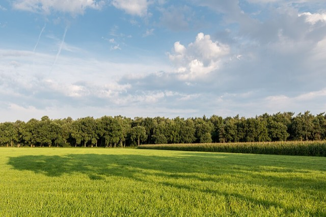 | 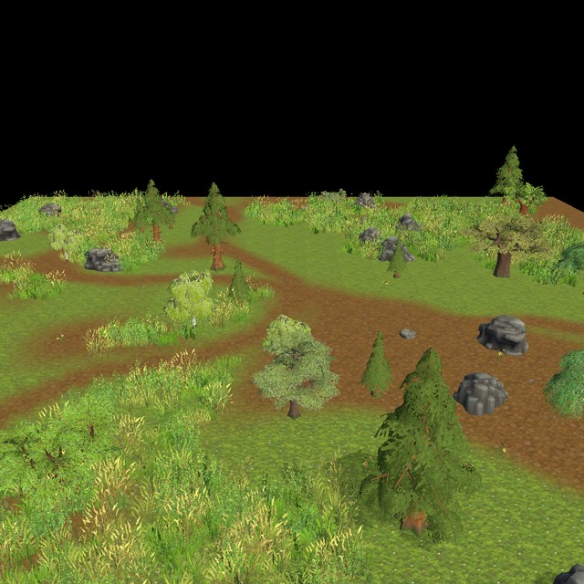 | 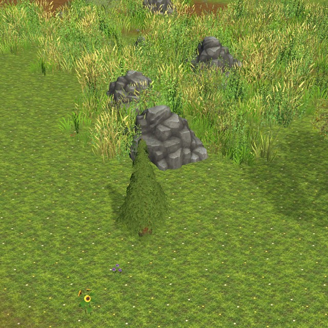 |

**Matches:** open green meadow with a few trees and paths.

**Still missing:**
- far fewer brown soil patches — a real meadow is unbroken grass (the patches follow the shared patch amount)
- short grass everywhere between the bunches (a short-grass ground prop, or a lower grass bunch)

*Photo: [Dülmen, Hausdülmen, Wiese -- 2015 -- 8506](https://commons.wikimedia.org/wiki/File:D%C3%BClmen,_Hausd%C3%BClmen,_Wiese_--_2015_--_8506.jpg) — Dietmar Rabich, CC BY-SA 4.0.*

## Forest — 65%

**Ground:** mud · leaf-litter patches · soil road. **Props:** all trees, ferns/mushrooms/bush ×2, grass ×0.2, stumps, rocks.

| Real | Ours — wide | Ours — close |
| --- | --- | --- |
| 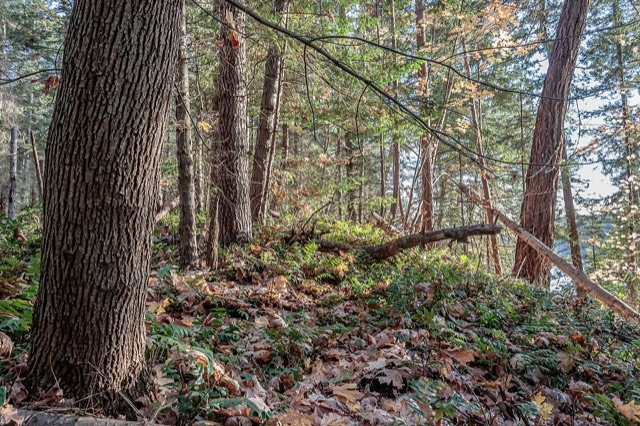 | 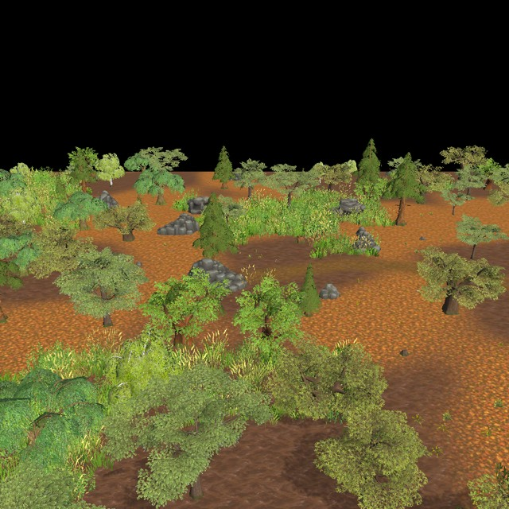 | 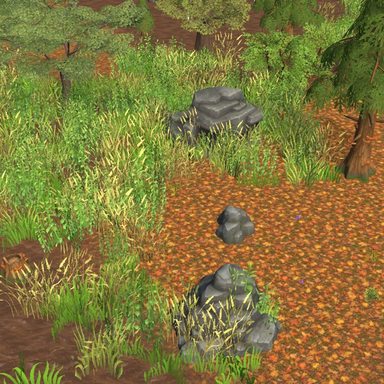 |

**Matches:** the leaf-covered floor, ferns under mixed trees.

**Still missing:**
- fallen logs and moss-covered stones
- taller trees, so the canopy closes over the paths

*Photo: [Autumn forest at Drumbeg Provincial Park](https://commons.wikimedia.org/wiki/File:Autumn_forest_at_Drumbeg_Provincial_Park.jpg) — Laurie MacBride, CC BY-SA 4.0.*

## Highland — 55%

**Ground:** alpine_grass · gravel-scree patches · dirt road. **Props:** pines and birch ×0.3, grass ×0.25, rocks ×3.

| Real | Ours — wide | Ours — close |
| --- | --- | --- |
| 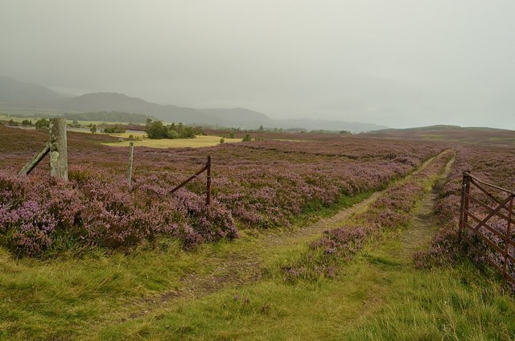 | 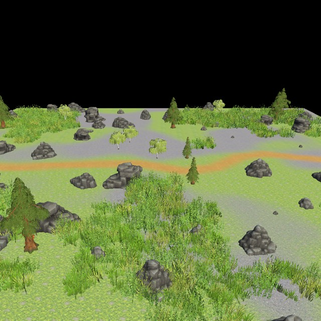 | 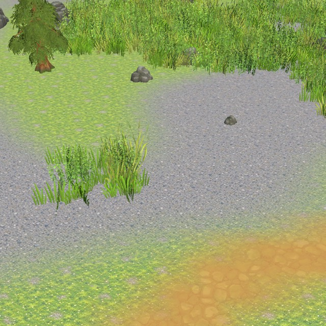 |

**Matches:** a near-treeless moor of turf, scree and boulders.

**Still missing:**
- heather — the purple ground cover that makes a moor read as a moor; it needs a new patch tile (none of our props or tiles is heather)

*Photo: [Moorland Gateway near Luibleathann, Scottish Highlands - geograph.org.uk - 5693500](https://commons.wikimedia.org/wiki/File:Moorland_Gateway_near_Luibleathann,_Scottish_Highlands_-_geograph.org.uk_-_5693500.jpg) — Andrew Tryon, CC BY-SA 2.0.*

## Peaks — 80%

**Ground:** gravel_scree · snow patches · frozen-dirt road. **Props:** no trees, pine stumps, rocks ×5.

| Real | Ours — wide | Ours — close |
| --- | --- | --- |
| 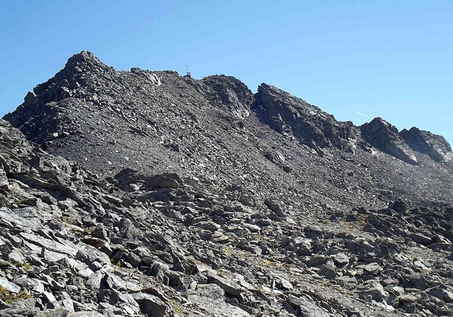 | 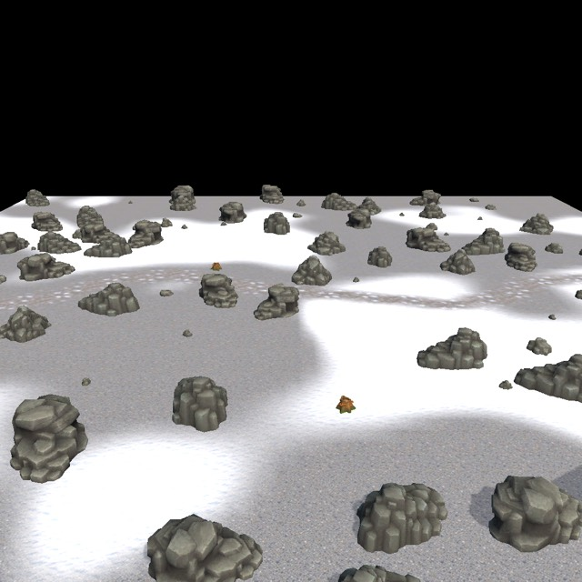 | 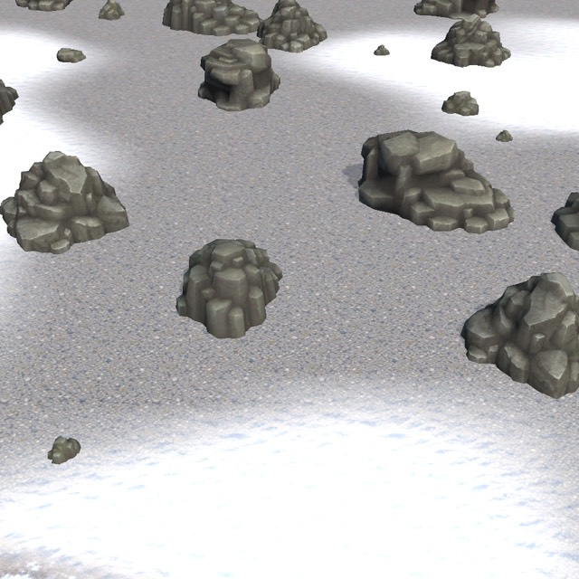 |

**Matches:** a bare scree field of boulders with snow lying in patches.

**Still missing:**
- slopes: the real peak is steep ground, ours is flat

*Photo: [Gran tempesta versante nw](https://commons.wikimedia.org/wiki/File:Gran_tempesta_versante_nw.jpg) — F Ceragioli, CC BY-SA 3.0.*

## Snow — 80%

**Ground:** snow · frozen-dirt patches · gravel road. **Props:** pines, pine stumps, rocks ×1.5, and the snow blanket always on.

| Real | Ours — wide | Ours — close |
| --- | --- | --- |
| 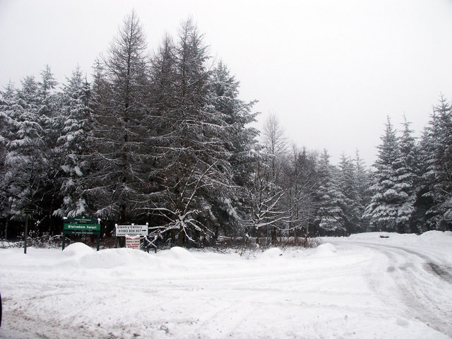 | 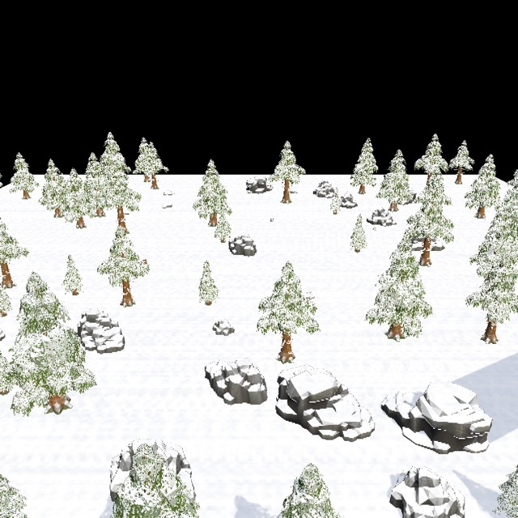 | 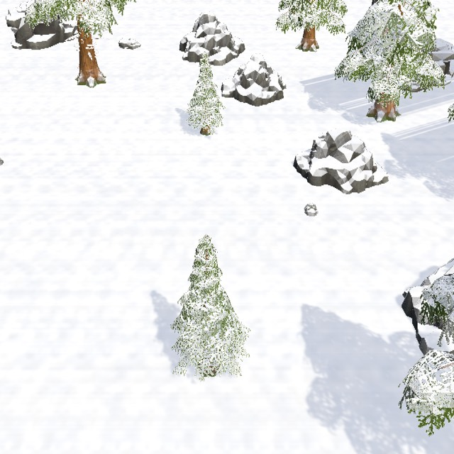 |

**Matches:** the snow-laden spruces and a white, even ground.

**Still missing:**
- drifts or small mounds, so the white ground is not perfectly flat
- snow falling often (the parked weather-frequency idea)

*Photo: [Blairadam Forest - geograph.org.uk - 137311](https://commons.wikimedia.org/wiki/File:Blairadam_Forest_-_geograph.org.uk_-_137311.jpg) — Simon Johnston, CC BY-SA 2.0.*

## Steppe — 55%

**Ground:** steppe_grass · cracked-earth patches · dirt road. **Props:** rye ×0.3, rocks.

| Real | Ours — wide | Ours — close |
| --- | --- | --- |
| 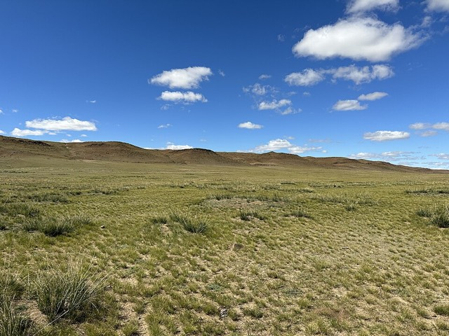 | 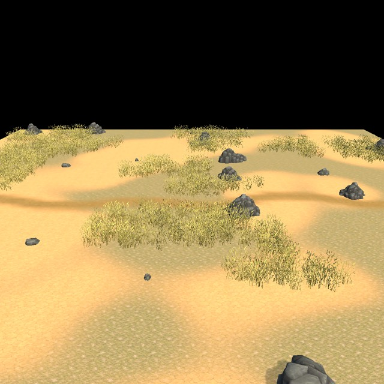 | 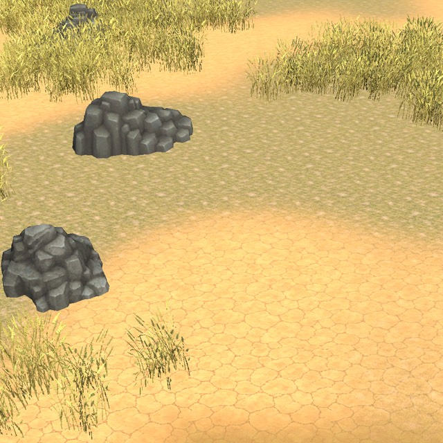 |

**Matches:** the dry, golden tone and sparse tussocks with bare ground between.

**Still missing:**
- lower tussocks — the rye is still knee-high where steppe grass is ankle-high
- rolling ground and a far horizon (the map is flat and closed)

*Photo: [Grassland at Dundgovi, Mongolia 02](https://commons.wikimedia.org/wiki/File:Grassland_at_Dundgovi,_Mongolia_02.jpg) — ノボホショコロトソ, CC BY 4.0.*

## Coast — 35%

**Ground:** beach_sand · wet-sand patches · pebble road. **Props:** rocks ×3.

| Real | Ours — wide | Ours — close |
| --- | --- | --- |
| 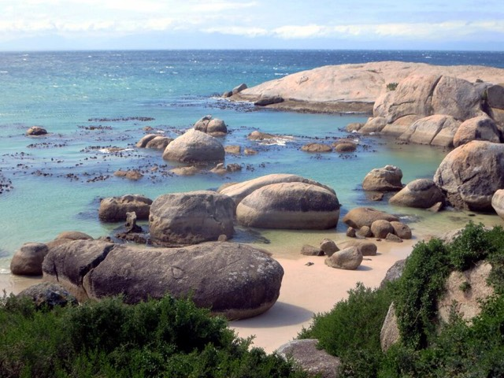 | 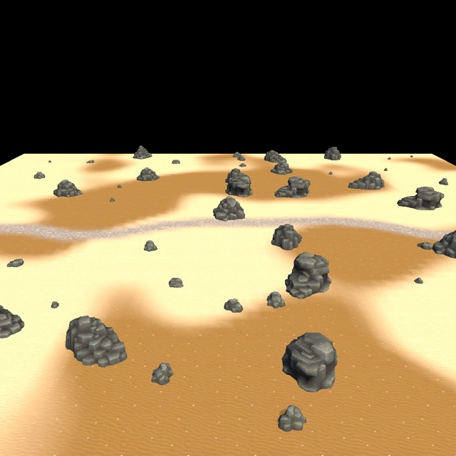 | 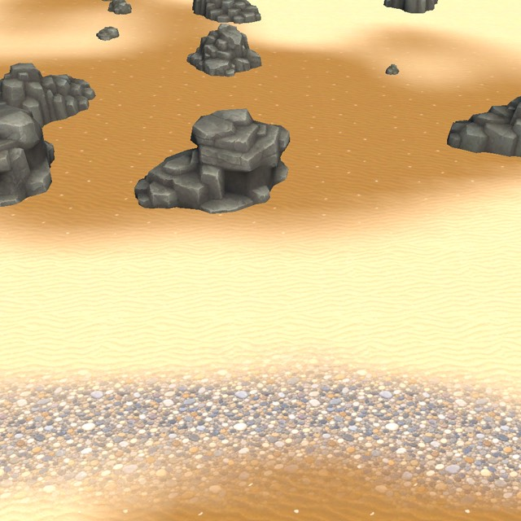 |

**Matches:** pale sand, damp patches and boulders.

**Still missing:**
- the sea — a water edge along one side of the map
- big rounded boulders (ours are angular and grey)
- shells, driftwood, dune grass

*Photo: [Boulders Beach (16612639728)](https://commons.wikimedia.org/wiki/File:Boulders_Beach_(16612639728).jpg) — David Stanley from Nanaimo, Canada, CC BY 2.0.*

## Desert — 45%

**Ground:** dune_sand · cracked-earth patches · sandstone road. **Props:** rocks ×0.5.

| Real | Ours — wide | Ours — close |
| --- | --- | --- |
| 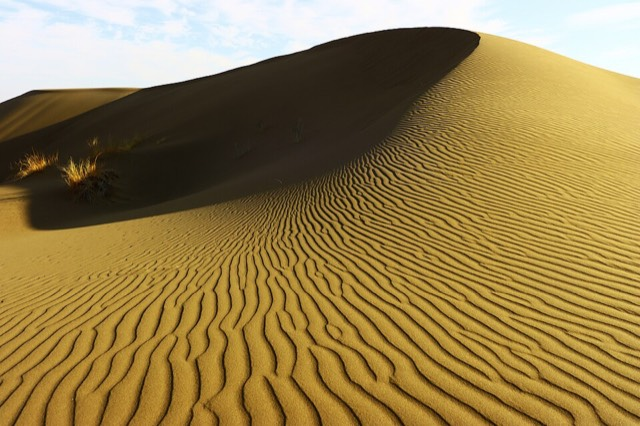 | 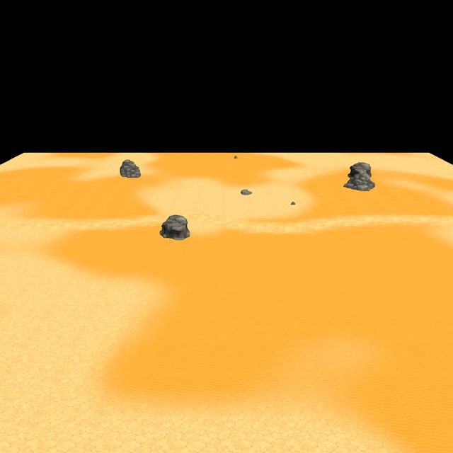 | 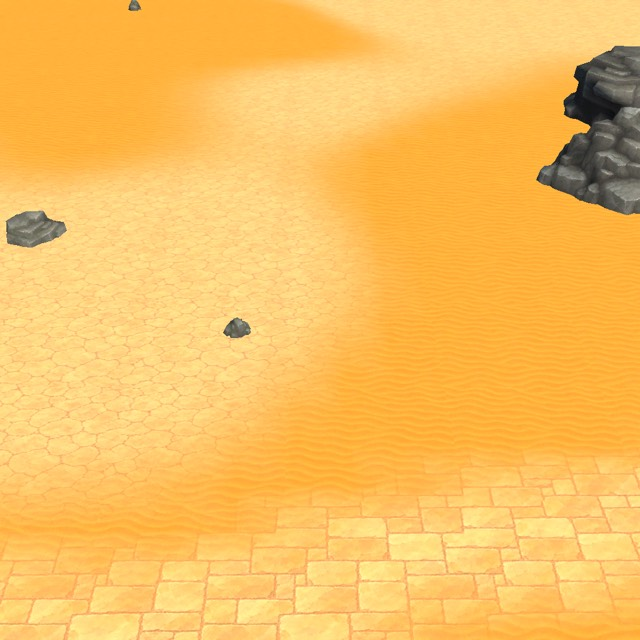 |

**Matches:** open rippled orange sand.

**Still missing:**
- dunes: the real desert is shaped ground, ours is flat
- dry shrubs and cacti (already on the props-to-make list)

*Photo: [A sand dune in the Maranjab Desert of Iran- Photographer Mostafa Meraji 01](https://commons.wikimedia.org/wiki/File:A_sand_dune_in_the_Maranjab_Desert_of_Iran-_Photographer_Mostafa_Meraji_01.jpg) — Mostafameraji, CC BY-SA 4.0.*

## Volcanic — 55%

**Ground:** black_ash · glowing-crack patches (patch amount 0.5) · cooled-lava road. **Props:** rocks ×4.

| Real | Ours — wide | Ours — close |
| --- | --- | --- |
| 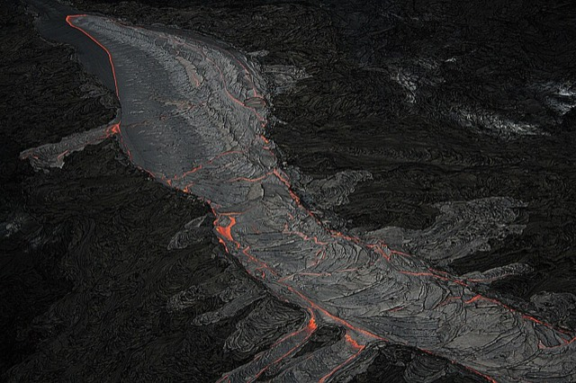 | 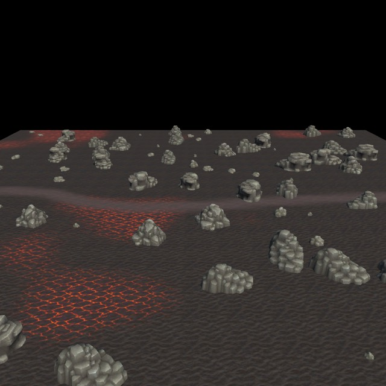 | 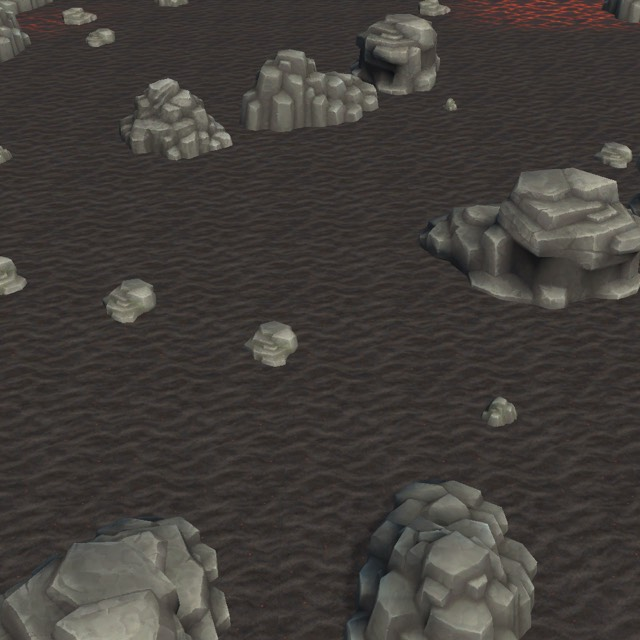 |

**Matches:** black ground with glowing cracks in smaller runs, and a boulder field.

**Still missing:**
- black lava rocks instead of grey boulders
- steam or smoke rising from the cracks

*Photo: [Lava channel with overflows edit 4](https://commons.wikimedia.org/wiki/File:Lava_channel_with_overflows_edit_4.jpg) — Brocken Inaglory Original uploader was Brocken Inaglory, CC BY-SA 3.0.*

## Swamp — 40%

**Ground:** marsh_grass · mud patches · soil road. **Props:** willows and stumps ×0.8, ferns and mushrooms ×1.5, grass ×0.6, and puddles always on.

| Real | Ours — wide | Ours — close |
| --- | --- | --- |
| 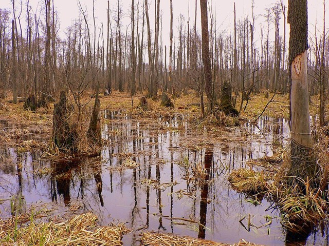 | 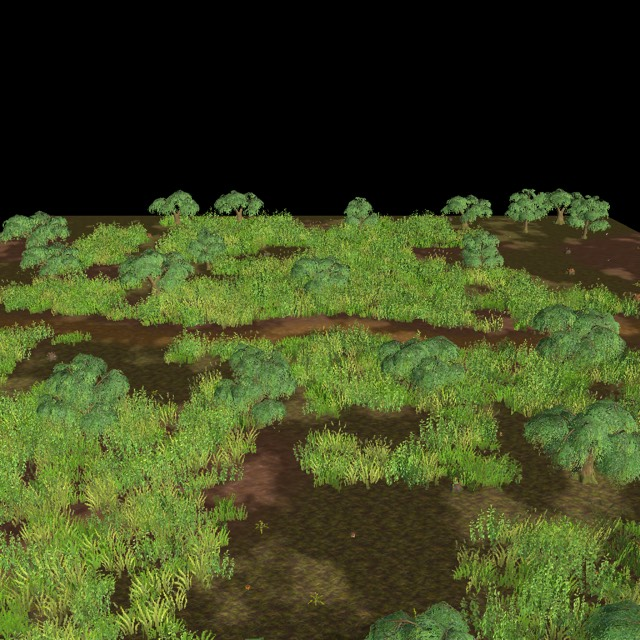 | 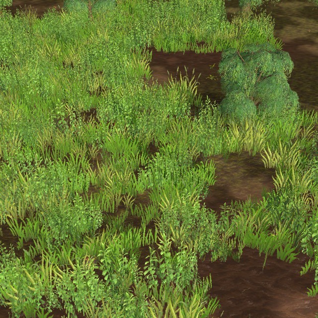 |

**Matches:** soaked ground, fewer willows among dead stumps.

**Still missing:**
- water that looks like water: in these pictures the puddles read as dark wet mud (the shine comes from the reflection, which only draws on High)
- reeds and cattails (on the props-to-make list)
- dead standing trunks (the stumps are too short to read as trunks)

*Photo: [Poland Kampinos April 1](https://commons.wikimedia.org/wiki/File:Poland_Kampinos_April_1.jpg) — Wojsyl, CC BY-SA 3.0.*

## Sacred — 30%

**Ground:** clover · meadow-grass patches · flagstone road. **Props:** birch ×0.5, flowers ×4, grass ×0.7.

| Real | Ours — wide | Ours — close |
| --- | --- | --- |
| 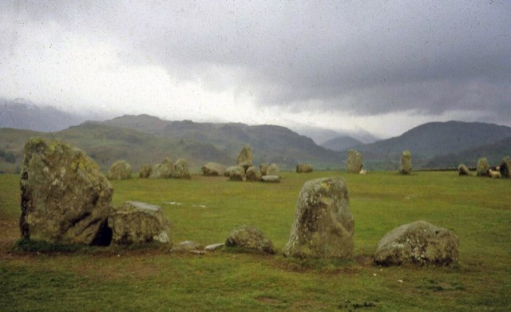 | 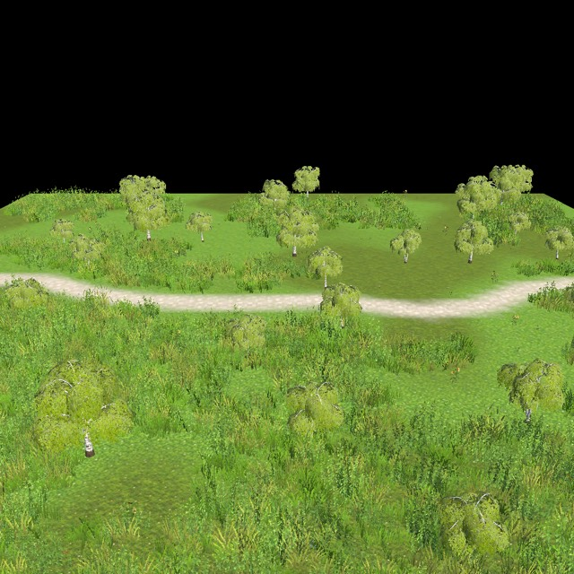 | 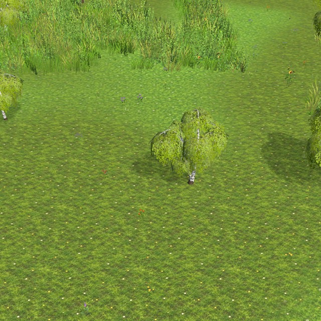 |

**Matches:** a green, gentle meadow.

**Still missing:**
- standing stones — they are what makes the place sacred, and no prop we have stands upright (the stones and rocks all lie flat)
- short grass, so the stones and flowers can be seen

*Photo: [Castlerigg Stone Circle - geograph.org.uk - 2402511](https://commons.wikimedia.org/wiki/File:Castlerigg_Stone_Circle_-_geograph.org.uk_-_2402511.jpg) — Trevor Rickard, CC BY-SA 2.0.*

## Haunted — 20%

**Ground:** dead_grass · grave-dirt patches · dark-cobble road. **Props:** stumps as trees, mushrooms ×2, rocks, stumps.

| Real | Ours — wide | Ours — close |
| --- | --- | --- |
| 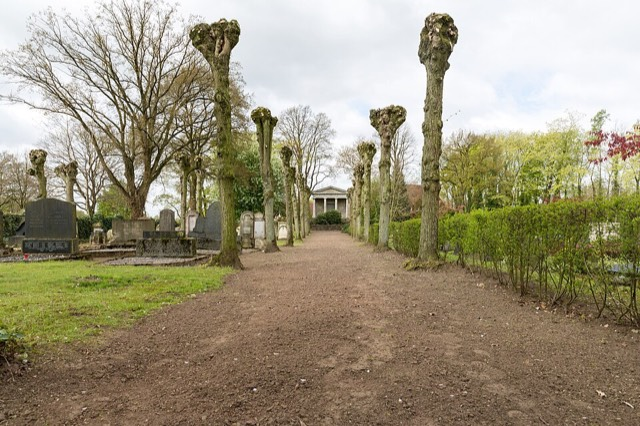 | 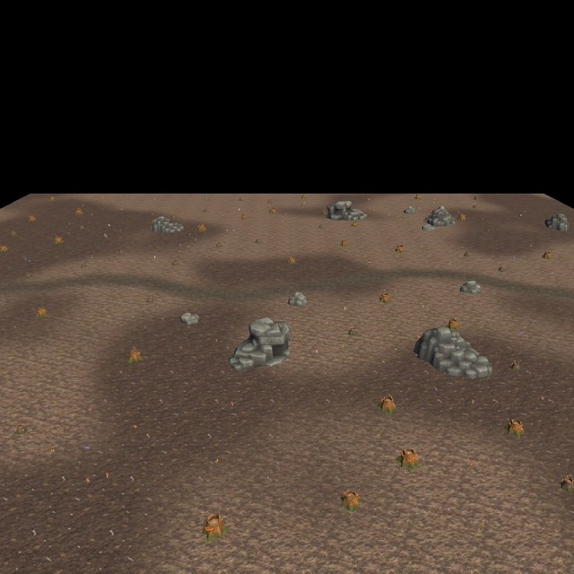 | 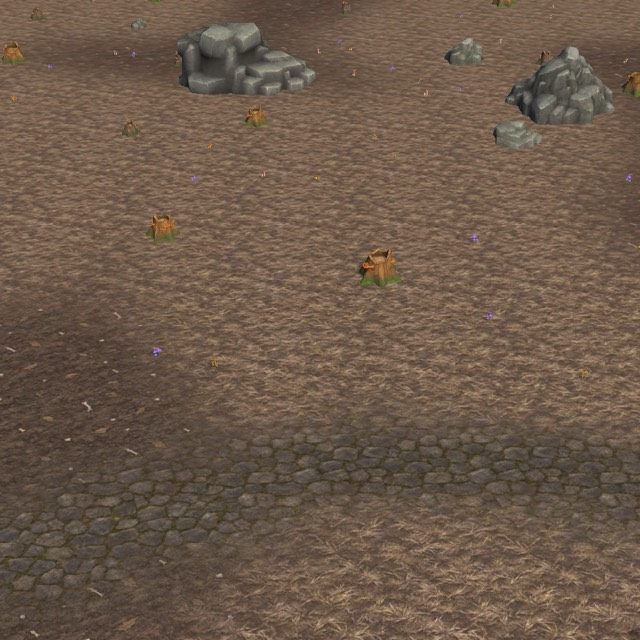 |

**Matches:** the bare, dead ground.

**Still missing:**
- gravestones (on the props-to-make list)
- dead or gnarled trees (on the props-to-make list); the stumps are too small to read
- iron fences or low walls

*Photo: [Dülmen, Jüdischer Friedhof -- 2017 -- 6806](https://commons.wikimedia.org/wiki/File:D%C3%BClmen,_J%C3%BCdischer_Friedhof_--_2017_--_6806.jpg) — Dietmar Rabich, CC BY-SA 4.0.*

## Mist — 55%

**Ground:** mist_moss · grey-silt patches · soil road. **Props:** willows ×0.8, ferns and mushrooms ×1.5, and fog always on.

| Real | Ours — wide | Ours — close |
| --- | --- | --- |
| 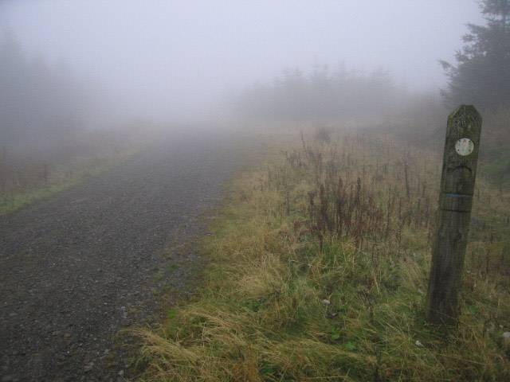 | 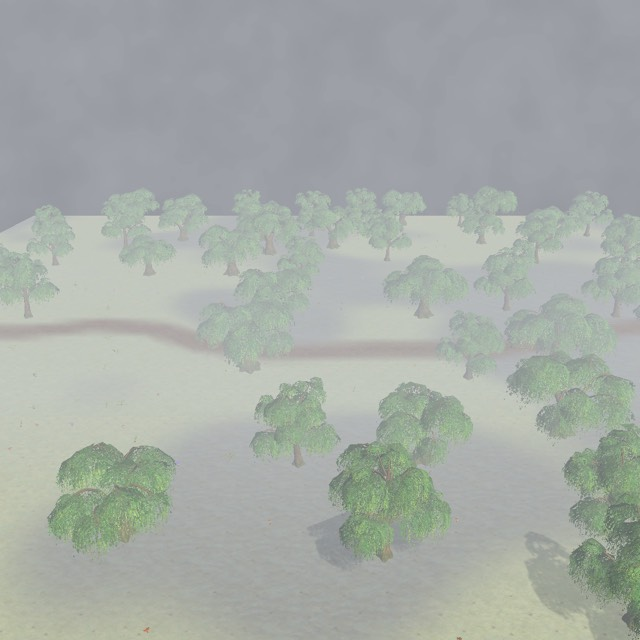 | 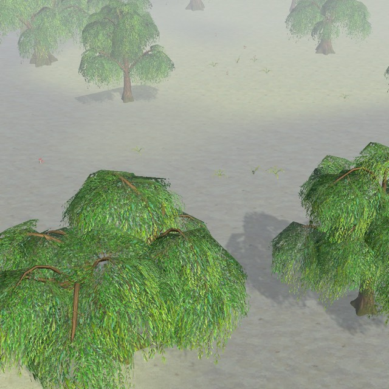 |

**Matches:** the fog: near trees stay clear and the far side fades out, like the real misty path.

**Still missing:**
- bare, thin trees fading into the fog — the willows are round and leafy
- a lower, ground-hugging mist rather than an even haze

*Photo: [Misty forest - geograph.org.uk - 1035967](https://commons.wikimedia.org/wiki/File:Misty_forest_-_geograph.org.uk_-_1035967.jpg) — Neville Goodman, CC BY-SA 2.0.*

## Corrupted — 20%

**Ground:** blighted_grass · blighted-soil patches · dark-cobble road. **Props:** stumps as trees, rocks ×1.5.

| Real | Ours — wide | Ours — close |
| --- | --- | --- |
| 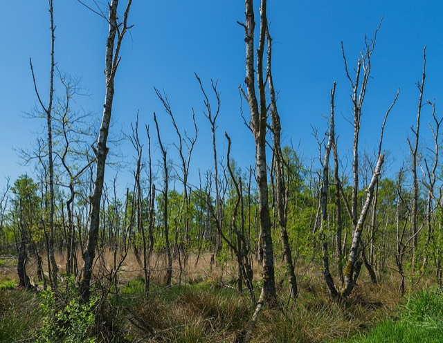 | 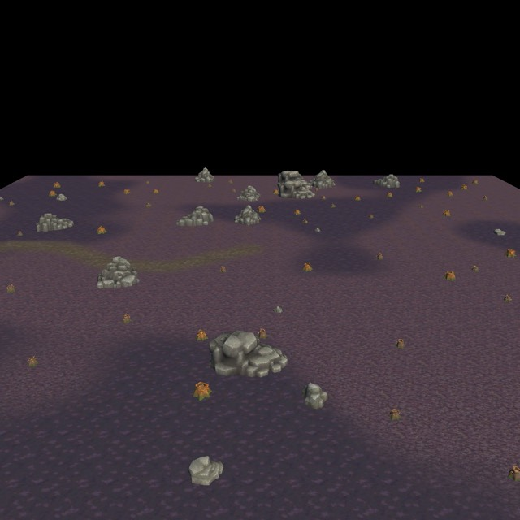 | 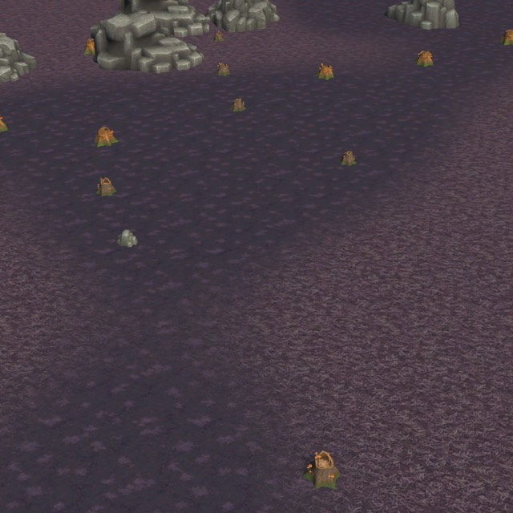 |

**Matches:** the dead, withered ground.

**Still missing:**
- standing dead trees (twisted dead trees are on the props-to-make list)
- dry grass tufts in a dull colour (the rye prop is golden, which reads cheerful on this ground)

*Photo: [Naturschutzgebiet Emsdettener Venn 26](https://commons.wikimedia.org/wiki/File:Naturschutzgebiet_Emsdettener_Venn_26.jpg) — J.-H. Janßen, CC BY-SA 4.0.*

## Related

- [Biomes — Ground Tiles and Props](biomes.md) — each biome's tiles, props, the props still to make, and the weather a
  biome always has.
- [The World Map — Twelve Homelands](world-map.md) — which biome each homeland map uses.
